# Laporan Praktikum 6: JavaScript DOM dan Event Handling

## Identitas Praktikum
* **Mata Kuliah:** Pemrograman Web
* **Dosen Pengampu:** Agung Nugroho, S.Kom., M.Kom.
* **Nama:** Nur Muhammad Baha Uddin Naqsabandi
* **NIM:** 312510264
* **Program Studi:** Teknik Informatika
* **Fakultas:** Teknik
* **Instansi:** Universitas Pelita Bangsa
* **Tahun:** 2026

---

## Deskripsi Singkat
Praktikum ini bertujuan untuk memahami dan mengimplementasikan konsep *Document Object Model* (DOM) serta *Event Handling* pada JavaScript dasar. Melalui 6 latihan utama, dibuat sebuah halaman web interaktif yang mencakup manipulasi elemen HTML, merespons tindakan pengguna (klik dan input), mengubah kelas CSS secara dinamis, melakukan validasi form pendaftaran, hingga membangun aplikasi daftar tugas (*To-do List*) sederhana.

---

## Struktur File Proyek
```text
Lab6_dom_event/
├── index.html     # Menyimpan seluruh struktur elemen HTML (Latihan 1-6)
├── style.css      # Mengatur tata letak dan gaya CSS (Latihan 3 & 6)
├── script.js     # Berisi logika DOM dan Event Listener (Latihan 1-6)
└── README.md      # Dokumentasi lengkap praktikum
```

---

## Hasil Pelaksanaan Latihan dan Pengujian

### 1. Mengubah Teks dengan DOM
Memilih elemen HTML berdasarkan `id` (`judul` dan `pesan`) lalu mengubah konten teksnya menggunakan properti `textContent` melalui JavaScript.

* **Hasil Tampilan Mengubah Teks:**  
  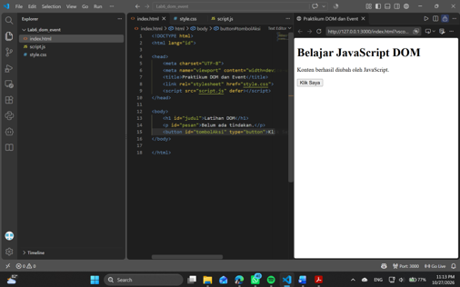

---

### 2. Event Click
Menambahkan *event listener* `click` pada tombol untuk merespons tindakan klik pengguna dan menampilkan waktu terkini menggunakan `Date().toLocaleTimeString()`.

* **a. Kondisi Valid (Pengujian Berhasil):**  
  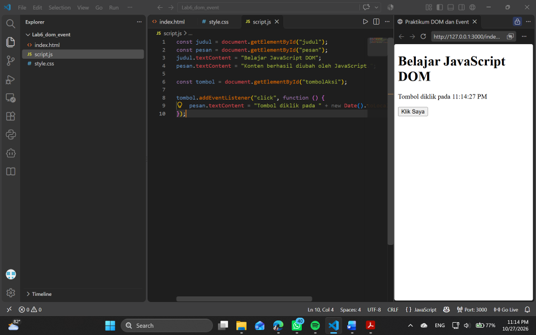  
  *Keterangan:* Menghapus variabel `pesan` yang dideklarasikan ganda/double agar kode dapat berjalan lancar.

* **b. Kondisi Tidak Valid (Error Deklarasi Ganda):**  
  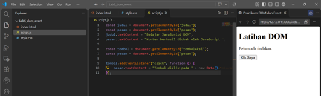  
  *Keterangan:* Deklarasi `const` tidak terindeks jika terdapat variabel dengan nama yang sama dideklarasikan 2 kali dalam cakupan (*scope*) yang sama.

---

### 3. Mengubah Kelas dan Gaya CSS
Menggunakan `classList.toggle()` untuk menambah atau menghapus kelas CSS (`highlight` dan `teks-besar`) secara dinamis saat tombol diklik.

* **a. Kondisi Tidak Valid (Kesalahan Penempatan Kode):**  
  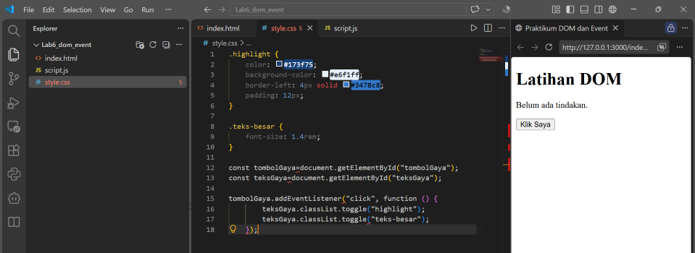  
  *Keterangan:* Jika kode JavaScript dimasukkan langsung ke dalam file `style.css`, gaya otomatis tidak berganti/berubah karena sintaks JS harus dipisahkan ke file `script.js`.

* **b. Kondisi Valid (Gaya Berhasil Berubah):**  
  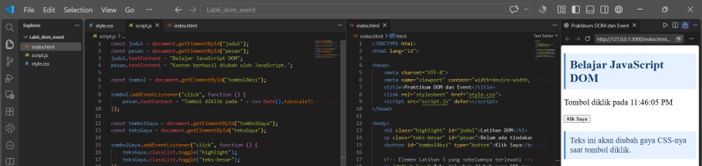  
  *Keterangan:* Gaya pada halaman langsung berubah setelah kode dipindahkan ke `script.js` serta penambahan elemen class `highlight` dan `teks-besar` pada `index.html`.

---

### 4. Event Input dan Penghitung Karakter
Menangkap event `input` pada elemen `<input>` teks untuk menghitung dan menampilkan jumlah karakter secara *real-time*.

* **a. Mengetik Karakter:**  
  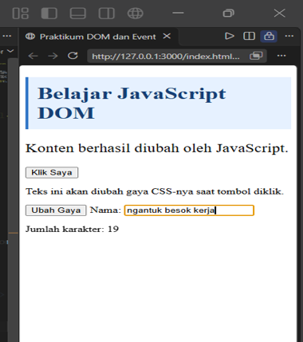  
  *Keterangan:* Jumlah karakter bertambah secara langsung saat pengguna mengetik teks.

* **b. Menghapus Karakter:**  
  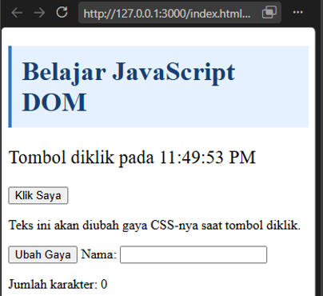  
  *Keterangan:* Indikator angka kembali berkurang atau menjadi 0 saat teks dihapus.

* **c. Menempel Teks (Paste):**  
  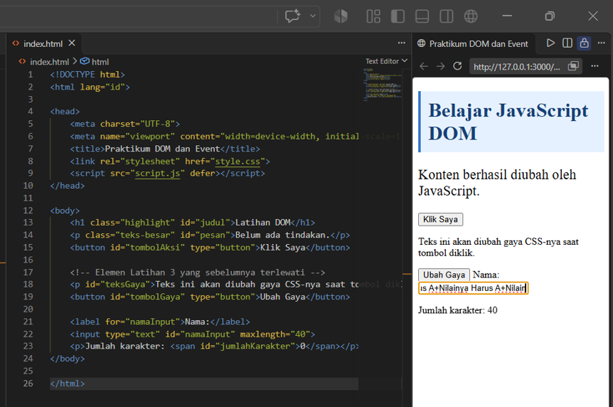  
  *Keterangan:* Proses menempelkan teks terbatas oleh atribut `maxlength="40"` yang membatasi maksimal input hingga 40 karakter.

---

### 5. Validasi Form Pendaftaran
Menerapkan validasi form pada event `submit` untuk mengecek kelengkapan nama, format email (Regex), serta rentang angka usia (17–100 tahun) dengan mencegah *reload* halaman menggunakan `event.preventDefault()`.

* **a. Kondisi Semua Input Kosong:**  
    
  *Keterangan:* Menampilkan pesan error `"Nama wajib diisi."` saat form disubmit dalam keadaan kosong.

* **b. Kondisi Nama Kosong:**  
  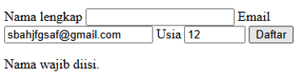  
  *Keterangan:* Menampilkan pesan error `"Nama wajib diisi."` meskipun email dan usia sudah terisi.

* **c. Kondisi Email Tidak Valid:**  
  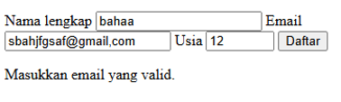  
  *Keterangan:* Menampilkan pesan error `"Masukkan email yang valid."` saat domain email menggunakan koma atau format tidak sah.

* **d. Kondisi Usia Di Bawah 17 Tahun:**  
  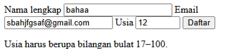  
  *Keterangan:* Menampilkan pesan error `"Usia harus berupa bilangan bulat 17–100."` jika usia diisi di bawah batas minimum.

* **e. Kondisi Semua Input Valid:**  
  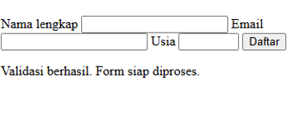  
  *Keterangan:* Menampilkan pesan `"Validasi berhasil. Form siap diproses."` dan mengosongkan kembali form (*reset*).

---

### 6. Daftar Tugas Sederhana (To-do List)
Membuat aplikasi penambah tugas interaktif dengan fitur `document.createElement()`, `appendChild()`, serta tombol saklar untuk menandai tugas selesai (*strikethrough*).

* **Hasil Pengujian To-do List:**  
  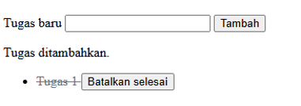  
  *Keterangan:* Tugas berhasil ditambahkan ke daftar `<ul>` dan statusnya dapat diubah menjadi "Selesai" atau "Batalkan selesai".

---

## Cara Menjalankan Proyek
1. Clone atau unduh repository ini ke komputer Anda.
2. Pastikan file `index.html`, `style.css`, dan `script.js` berada dalam satu folder kerja.
3. Buka file `index.html` menggunakan browser modern (Google Chrome, Mozilla Firefox, atau Microsoft Edge).
4. Gunakan ekstensi **Live Server** di VS Code untuk pengalaman pengujian lokal yang optimal.